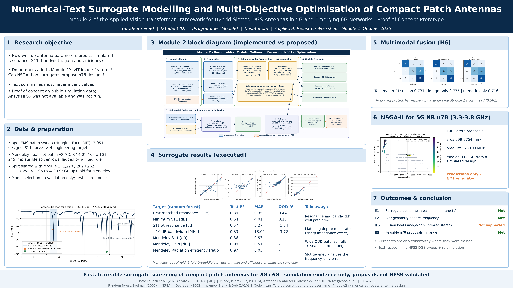
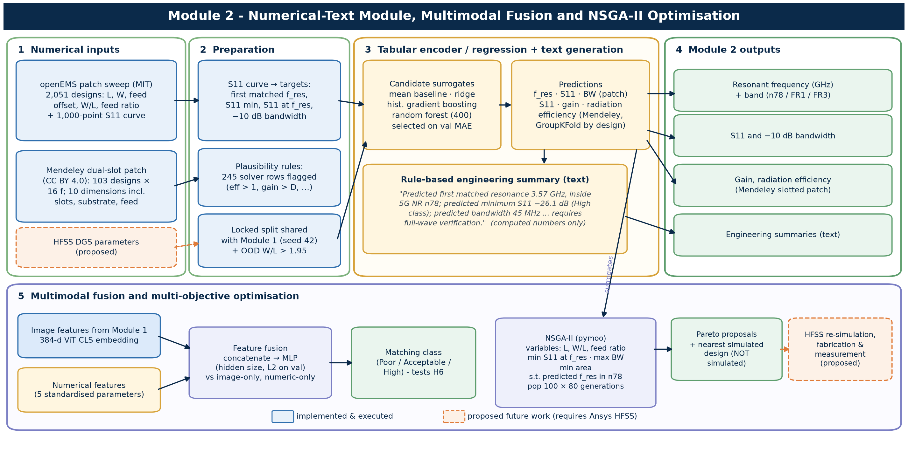
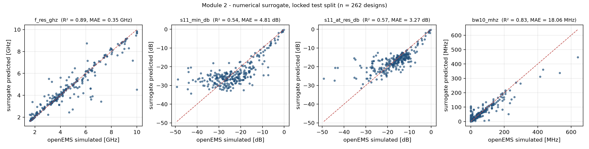
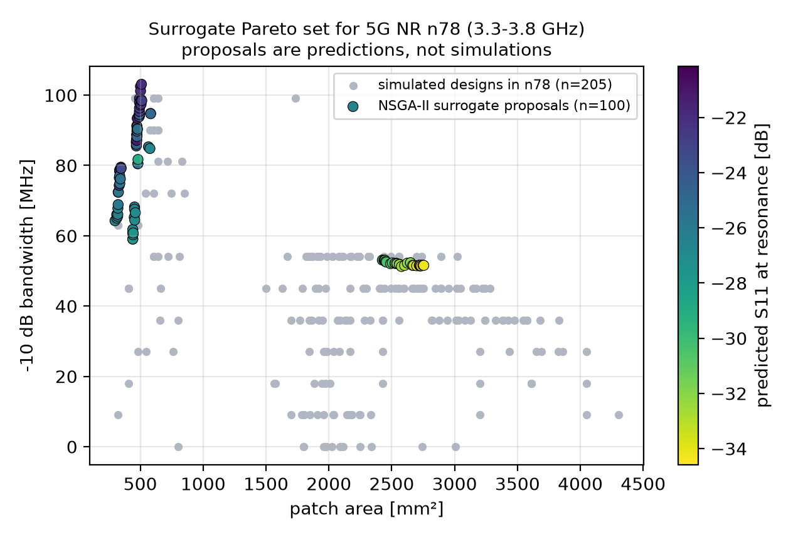

# Module 2 - Numerical-Text Surrogate Modelling and Multi-Objective Optimisation of Compact Patch Antennas

*Numerical-text module, multimodal fusion and NSGA-II optimisation of the Applied Vision Transformer framework for hybrid-slotted DGS
antennas in 5G and emerging 6G networks - a reproducible proof-of-concept prototype*

> **Status in one line:** the numerical-text module was implemented and **executed end-to-end on CPU** on two verified public simulation
> datasets: random-forest surrogates, template-based engineering summaries, fusion with Module 1's ViT embeddings and an NSGA-II search
> for 5G NR n78. **Ansys HFSS was not available and was not run; the optimised designs are surrogate predictions and have not been simulated.**
>
> Module 1 (image-based Vision Transformer) is a separate repository:
> `https://github.com/<your-github-username>/module1-vit-antenna-image-classification`.



## Research objective

Determine how well documented antenna parameters predict simulated electromagnetic performance, whether these numbers add to image
features, and whether surrogate-based multi-objective optimisation can propose credible compact designs for a 5G band - while keeping
every generated number and sentence traceable to a model output or a simulated reference. The pre-registered fusion hypothesis H6 is in
[docs/HYPOTHESES.md](docs/HYPOTHESES.md).

## Block diagram



| Component | Implementation | Status |
|---|---|---|
| Target extraction | first matched resonance, S11 min, S11 at resonance, −10 dB bandwidth from each 1,000-point S11 curve | executed |
| Surrogates | mean / ridge / histogram gradient boosting / random forest, selected on validation MAE | executed |
| Engineering summaries | deterministic template that only verbalises computed numbers | executed |
| Multimodal fusion | 384-d ViT embedding (from Module 1) + 5 numeric features → MLP; vs image-only and numeric-only | executed |
| Optimisation | NSGA-II (pymoo): min S11, max bandwidth, min area, s.t. predicted f_res in n78 | executed; **proposals not simulated** |
| HFSS DGS sweep, re-simulation, fabrication | — | proposed |

## Verified datasets

| Dataset | Source | Licence | Used for |
|---|---|---|---|
| Rectangular Patch Antenna Frequency Response (2,051 openEMS designs) | [Hugging Face](https://huggingface.co/datasets/becklabash/rectangular-patch-antenna-freq-response), rev `4be72a2`; LaBash et al., arXiv:2505.18188 | MIT | surrogates, fusion, NSGA-II |
| Antenna Parameters Dataset (103 dual-slot designs × 16 f) | [Mendeley 10.17632/3gxr2vvd9n.2](https://doi.org/10.17632/3gxr2vvd9n.2) | CC BY 4.0 | S11, gain and efficiency regression |
| Module 1 ViT embeddings | Module 1 repository (run `vit_finetune_patch_perf_class_s42`), SHA-256 in `provenance.json` | derived | fusion only |

Target definitions, the plausibility rule and the QC record are in [docs/DATA_CARD.md](docs/DATA_CARD.md).

## Installation and reproduction

```bash
git clone https://github.com/<your-github-username>/module2-numerical-surrogate-antenna-design.git
cd module2-numerical-surrogate-antenna-design
python -m venv .venv
source .venv/bin/activate            # Windows: .venv\Scripts\activate
pip install -r requirements.txt      # no PyTorch needed

python -m src.download_data          # ~10 MB, SHA-256 checked
python -m src.preprocessing          # targets, cleaning, split check against data/splits
python -m src.numerical_model        # surrogates + engineering summaries
python -m src.fusion_optimization    # fusion + NSGA-II
pytest -q                            # 10 tests
python scripts/make_deliverables.py  # block diagram, poster, slides, Word + LaTeX report
```

Or run everything with `bash scripts/run_all.sh` (Windows: `powershell -File scripts\run_all.ps1`). See [docs/REPRODUCIBILITY.md](docs/REPRODUCIBILITY.md).

## Results (executed)

All numbers come from `results/metrics/`. Nothing here is estimated or illustrative.

**Patch surrogate (random forest, locked test split n = 262; OOD hold-out n = 307)**

| Target | Test R² | Test MAE | Mean-baseline MAE | OOD R² |
|---|---|---|---|---|
| First matched resonance | 0.89 | 0.35 GHz | 1.82 GHz | 0.44 |
| Minimum S11 | 0.54 | 4.8 dB | 7.4 dB | 0.13 |
| S11 at resonance | 0.57 | 3.3 dB | 5.6 dB | −1.54 |
| −10 dB bandwidth | 0.83 | 18 MHz | 55 MHz | −3.72 |

**Mendeley dual-slot patch (GroupKFold by design):** R² 0.86 for S11, 0.99 for gain, 0.97 for radiation efficiency; adding the geometry
roughly halves the error of a frequency-only model.

**Fusion (matching class, test macro-F1):** fused 0.737, image-only 0.775, numeric-only 0.716 → **H6 not supported**. The image-only MLP beats
Module 1's own ViT head (0.581), which supports Module 1's underfitting diagnosis.

**NSGA-II for NR n78 (3.3–3.8 GHz):** 100 surrogate proposals in two mode families (compact fundamental-mode patches, L ≈ 19–23 mm, and
larger higher-order-mode patches, L ≈ 39–41 mm), with a median distance of 0.08 SD to the nearest simulated design. **Not simulated**; see
`results/metrics/nsga2_pareto_n78.csv`. Example generated summaries are in `results/reports/engineering_summaries.md`.




Test status: `pytest` reports 10 passed (`results/test_report.txt`).

## Deliverables

| File | Content |
|---|---|
| [reports/module2_report.docx](reports/module2_report.docx) (+ `.pdf`, `.tex`) | Formal methodology and implementation report |
| [presentations/module2_presentation.pptx](presentations/module2_presentation.pptx) | Five-slide deck with presenter notes |
| [poster/module2_poster.png](poster/module2_poster.png) (+ `.pdf`) | 16:9 research poster, 300 dpi |
| [results/figures/module2_architecture.png](results/figures/module2_architecture.png) | Module 2 block diagram |
| [docs/](docs/) | Data card, model card, reproducibility, limitations, dataset survey, hypotheses |

## Repository layout

```
configs/default.yaml        single source of truth (seed, thresholds, split, surrogate / fusion / NSGA-II settings)
src/                        download_data, preprocessing, numerical_model, fusion_optimization, metrics, utils
scripts/                    run_all + deliverable generators (diagram, poster, slides, report, PDF export)
tests/                      target-extraction, split, cleaning-rule, embedding and optimisation tests
data/                       processed tables, split manifests, Module 1 embeddings, data dictionary (raw data git-ignored)
results/                    metrics (JSON/CSV), predictions, figures, engineering summaries
reports/  presentations/  poster/  docs/
```

## Responsible use

Surrogate predictions, summaries and Pareto proposals are **screening outputs on simulated data**. None may be presented as verified
antenna performance without full-wave simulation and, for deployment, fabrication and measurement.

## Citation

```
LaBash et al. (2025). Improving Generative Inverse Design of Rectangular Patch Antennas with Test Time Optimization. arXiv:2505.18188.
Mihad, M. F. H., Islam, M. M., Sojib, F. H. (2024). Antenna Parameters Dataset (v2). Mendeley Data. doi:10.17632/3gxr2vvd9n.2
Deb, K. et al. (2002). A fast and elitist multiobjective genetic algorithm: NSGA-II. IEEE TEVC 6(2).
```

Code: MIT licence (see [LICENSE](LICENSE)).
